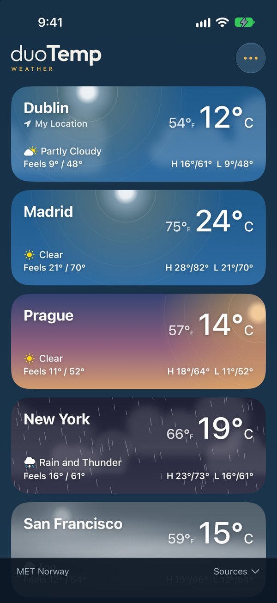
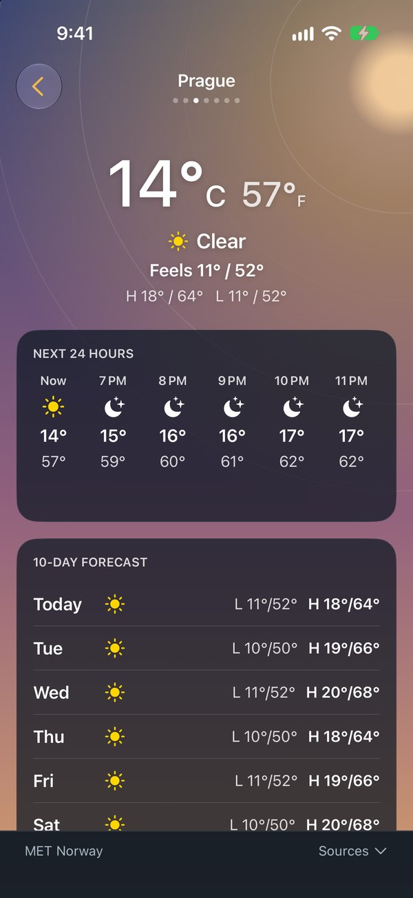
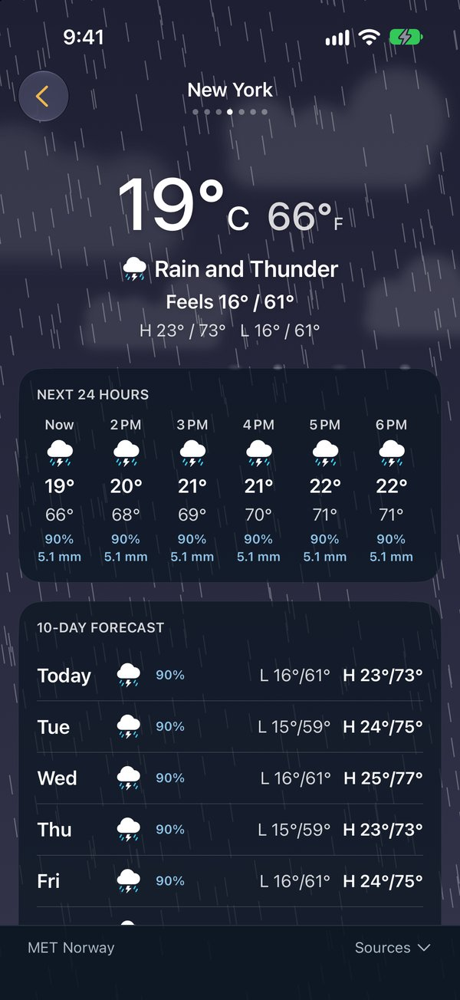
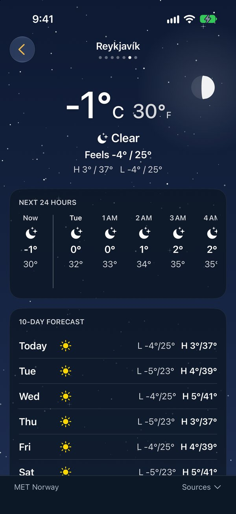
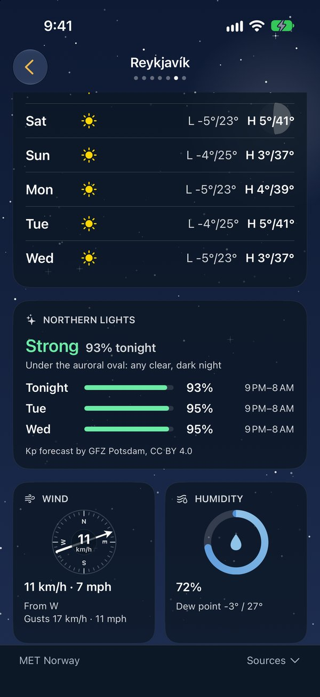
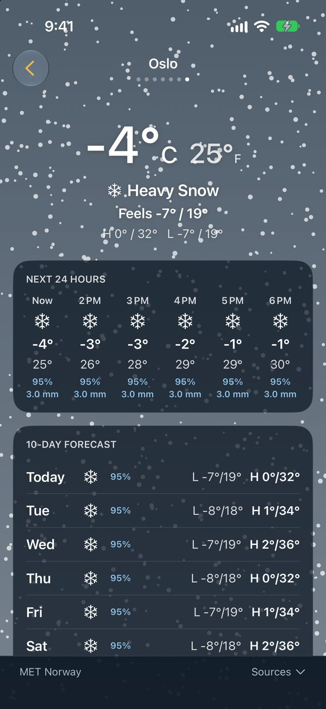

<h1 align="center">
  <picture>
    <source media="(prefers-color-scheme: dark)" srcset="Brand/svg/duotemp-lockup-on-dark.svg">
    
  </picture>
</h1>

Weather widgets for iPhone that show Celsius and Fahrenheit together, with feels-like on every size.

- Home Screen widgets for where you are or any saved place: small, and medium with a six-hour forecast.
- Choose which unit leads; the other is always beside it.
- Forecasts from [MET Norway](https://api.met.no) by default, with Apple Weather filling gaps or as the main source.

<p align="center">
  
  
  
</p>
<p align="center">
  
  
  
</p>

## Privacy
No accounts, analytics, ads or tracking. Your location stays on the device; only coordinates rounded to about 1 km are sent to the forecast provider you choose. Settings and cached forecasts live in the app's App Group container.

## Requirements
- Xcode 27.1 or later, iOS 18 or later.
- An Apple Developer account for WeatherKit, the App Group and running on a device.

## Setup
1. Open `Duotemp.xcodeproj`.
2. To build under your own account, create `Config/Local.xcconfig` (gitignored):
   ```
   BUNDLE_ID_PREFIX = com.example
   DEVELOPMENT_TEAM = YOURTEAMID
   ```
3. In the Apple Developer portal, enable **WeatherKit** on the App ID under both Capabilities and App Services. The App Group (`group.<prefix>.duotemp`) is registered automatically by Xcode signing.
4. Run the `Duotemp` scheme on a device, then add the widget from the Home Screen.

## Data sources
- **MET Norway**: Locationforecast 2.0 (the data behind Yr), [CC BY 4.0](https://api.met.no/doc/License). The app follows the [terms of service](https://api.met.no/doc/TermsOfService): an identifying User-Agent, cached responses honouring `Expires` and `If-Modified-Since`, and rounded coordinates. Builds call MET directly by default; to route MET and the aurora files through your own caching proxy, deploy `proxy/` with your own `APP_ID` and `ATTEST_SECRET` and set `PROXY_BASE_URL` in `Config/Local.xcconfig`. The app uses the proxy once App Attest has issued it a token, and calls the sources directly until then. duoTemp's own proxy only serves duoTemp's builds.
- **Apple Weather**: WeatherKit, with Apple's attribution shown in the app.

Every third-party service, framework and asset, with its licence, is listed in [THIRD_PARTY.md](THIRD_PARTY.md).

## Licence
The source code is licensed under the [Apache License 2.0](LICENSE). Copyright (c) 2026 David McPhearson.

Any paid features (such as radar maps or Apple Watch widgets) live in a separate private package and are not part of this repository or its licence.

## Name and logo
"duoTemp", "duoTemp Weather", the app icon and the logo are trademarks of David McPhearson and are not licensed under the Apache License. You may build and modify the code, but a distributed version must use its own name and icon and must not suggest it is duoTemp. The files in `Brand/` are © David McPhearson, all rights reserved, apart from the Outfit font in `Brand/fonts/` (SIL OFL). See [TRADEMARKS.md](TRADEMARKS.md) for what forks may and may not do.

## Contributing
Issues and suggestions are welcome. Pull requests aren't accepted yet: code contributions will need a contributor licence agreement, which isn't set up.
